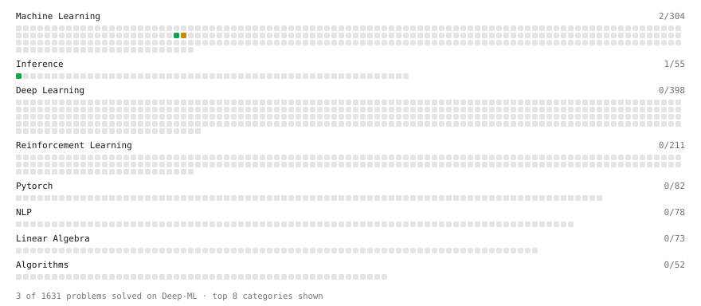

# Deep-ML

My machine learning practice from [Deep-ML](https://www.deep-ml.com). Every solution here was written by hand.

**5** solved · 2 problems · 0 labs · 3 math

[**Browse the interactive portfolio**](https://Rithesh-27.github.io/deep-ml/) to replay this filling in over time.

## Problems

| | Difficulty | Solved | |
| --- | --- | --- | --- |
| [Compute TTFT ITL and TPS from a Token Timestamp Stream](https://www.deep-ml.com/problems/411) | easy | 2026-10-19 | [solution](problems/0411-compute-ttft-itl-and-tps-from-a-token-timestamp-stream) |
| [End-to-End Latency Decomposition](https://www.deep-ml.com/problems/413) | medium | 2026-10-19 | [solution](problems/0413-end-to-end-latency-decomposition) |

## Math

| | Difficulty | Solved | |
| --- | --- | --- | --- |
| [Bytes in the KV Cache (MHA, GQA, MQA, MLA)](https://www.deep-ml.com/math-problems/62) | easy | 2026-09-16 | [solution](math/0062-bytes-in-the-kv-cache-mha-gqa-mqa-mla) |
| [Arithmetic Intensity of Matmul vs Decode Attention](https://www.deep-ml.com/math-problems/63) | medium | 2026-10-19 | [solution](math/0063-arithmetic-intensity-of-matmul-vs-decode-attention) |
| [Roofline: Time is the Max of Bytes/BW and FLOPs/Peak](https://www.deep-ml.com/math-problems/64) | medium | 2026-10-19 | [solution](math/0064-roofline-time-is-the-max-of-bytes-bw-and-flops-peak) |

---

_This file is regenerated by Deep-ML on every push._
